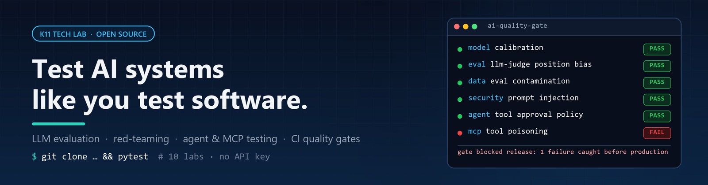

<div align="center">



# K11 Tech Lab

**Open-source labs for testing AI systems the way we test software: runnable, measurable, gated in CI.**

Every lab runs locally with **no API key**. Clone, `pytest`, and watch an AI system pass or fail.

[](https://github.com/K11-Software-Solutions)
[](https://www.linkedin.com/in/kavita-jadhav-tech/)
[](https://www.linkedin.com/newsletters/trustworthy-ai-engineering-7521267953363832832/)
[](https://www.linkedin.com/newsletters/sdet-insights-7354009267919613954/)

</div>

---

## 🤖 MCP servers for QA teams

Give Claude (or any MCP client) QA tools it can't fake. Each server checks its work against the real system and leaves evidence a reviewer can follow.

| Server | What it does | Get it |
|---|---|---|
| **[k11 Playwright QA](https://github.com/K11-Software-Solutions/k11techlab-playwright-qa-mcp)**<br>[](https://glama.ai/mcp/servers/K11-Software-Solutions/k11techlab-playwright-qa-mcp) | Turns user stories into Playwright tests with locators verified on the live page. When a redesign breaks them, heals each locator with a confidence score, reasons and the runner-up, and `heal-ci` opens a pull request with an audit report. | [](https://www.npmjs.com/package/k11-playwright-qa-mcp)<br>`npx -y k11-playwright-qa-mcp` |
| **[k11 Selenium QA](https://github.com/K11-Software-Solutions/k11techlab-selenium-qa-mcp)**<br>[](https://glama.ai/mcp/servers/K11-Software-Solutions/k11techlab-selenium-qa-mcp) | The same for Selenium, in **Python (pytest)** and **Java (JUnit 5 / TestNG)**. Fixes broken locators where they live, in Page Objects and `@FindBy` annotations, re-runs the tests and reverts any fix that doesn't pass. | [](https://pypi.org/project/k11-selenium-qa-mcp/)<br>`uvx k11-selenium-qa-mcp` |
| **[k11 API Contract QA](https://github.com/K11-Software-Solutions/k11techlab-api-contract-qa-mcp)**<br>[](https://glama.ai/mcp/servers/K11-Software-Solutions/k11techlab-api-contract-qa-mcp) | Tells you which services an API change breaks before merge, and why, down to the fields each consumer reads or sends. Works for **OpenAPI, Swagger, GraphQL, gRPC, AsyncAPI and SOAP**, checks deployed services for drift, and posts the verdict on the pull request. | [](https://pypi.org/project/k11-api-contract-qa-mcp/)<br>`uvx k11-api-contract-qa-mcp` |
| **[k11 API Functional QA](https://github.com/K11-Software-Solutions/k11techlab-api-functional-qa-mcp)**<br>[](https://glama.ai/mcp/servers/K11-Software-Solutions/k11techlab-api-functional-qa-mcp) | Writes and runs functional API tests from user stories: chained calls, value checks, **database checks** that prove the change was stored, and negative and boundary tests generated from the spec (every bad input must get a 4xx, never a 5xx). Guardrails keep it away from production data. | [](https://pypi.org/project/k11-api-functional-qa-mcp/)<br>`uvx k11-api-functional-qa-mcp` |
| **[LLM Assure](https://github.com/K11-Software-Solutions/k11techlab-llm-assurance-toolkit)**<br>[](https://glama.ai/mcp/servers/K11-Software-Solutions/k11techlab-llm-assurance-toolkit) | Red-teams your chatbot, RAG app or agent: 41 probes mapped to the OWASP Top 10 for LLM Applications, adaptive multi-turn attacks driven by Claude, a CI gate and an audit-ready HTML report. | [](https://pypi.org/project/k11-llm-assure-mcp/)<br>`uvx k11-llm-assure-mcp` |
| **[k11 Release Gate](https://github.com/K11-Software-Solutions/k11techlab-release-gate-mcp)**<br>[](https://glama.ai/mcp/servers/K11-Software-Solutions/k11techlab-release-gate-mcp) | Turns the evidence from all of the above (plus any JUnit report) into one release decision under a written policy: **ship, ship with conditions, needs a named person, or block**, with every reason, the evidence file it came from and its SHA-256. Deterministic, so it holds up in an audit. | [](https://pypi.org/project/k11-release-gate-mcp/)<br>`uvx k11-release-gate-mcp` |

All six are in the official [MCP Registry](https://registry.modelcontextprotocol.io) and install as **Claude Code plugins**: the UI testing servers add `/story-to-test` and `/heal-tests`, API Contract QA adds `/check-api-change` and `/api-contract-tests`, API Functional QA adds `/api-story-test` and `/api-negative-tests`, LLM Assure adds `/red-team` and `/assurance-report`, and Release Gate adds `/release-check`.

```text
/plugin marketplace add K11-Software-Solutions/k11techlab-playwright-qa-mcp
/plugin marketplace add K11-Software-Solutions/k11techlab-selenium-qa-mcp
/plugin marketplace add K11-Software-Solutions/k11techlab-api-contract-qa-mcp
/plugin marketplace add K11-Software-Solutions/k11techlab-api-functional-qa-mcp
/plugin marketplace add K11-Software-Solutions/k11techlab-llm-assurance-toolkit
/plugin marketplace add K11-Software-Solutions/k11techlab-release-gate-mcp
```

### 🛡️ The agent on top: Release Readiness

**[k11 Release Readiness Agent](https://github.com/K11-Software-Solutions/k11techlab-release-readiness-agent)** is a Claude Code plugin that answers *can we ship this branch?* `/release-readiness:check` works out which checks the change needs, gathers the evidence with the servers above in parallel sub-agents, and returns the Release Gate's deterministic verdict with every blocker explained. It never runs against production and never changes anything without asking.

```text
/plugin marketplace add K11-Software-Solutions/k11techlab-release-readiness-agent
/plugin install release-readiness@k11-release-readiness
```

Want help rolling these out across a test suite, a workshop for your team, or an MCP server built for your stack? [Get in touch](https://k11softwaresolutions.com/contact).

---

## 🧭 Start here: the AI Quality Engineering curriculum

New to testing AI? Start with the roadmap, then work through the labs in order. Each one ends with CI quality gates and negative controls, so you can see the tests catch real failures.

| # | Lab | What you'll learn to test |
|---|-----|---------------------------|
| 0 | [**becoming-ai-quality-engineer**](https://github.com/K11-Software-Solutions/becoming-ai-quality-engineer) | The roadmap: skills, tools, and a runnable RAG project with pytest, Playwright, Promptfoo and DeepEval |
| 1 | [llm-model-testing-lab](https://github.com/K11-Software-Solutions/llm-model-testing-lab) | Build a tiny GPT, then evaluate a real open-weights LLM: calibration, safety, bias, memorisation, quantization drift |
| 2 | [ai-evaluation-science-lab](https://github.com/K11-Software-Solutions/ai-evaluation-science-lab) | How far to trust an evaluator: LLM-judge bias, reliability statistics, sample sizes, drift |
| 3 | [ai-data-quality-lab](https://github.com/K11-Software-Solutions/ai-data-quality-lab) | Eval contamination, wrong labels, stale RAG documents, personal data, data contracts |
| 4 | [ai-security-testing-lab](https://github.com/K11-Software-Solutions/ai-security-testing-lab) | Prompt injection, jailbreaks, prompt leakage, exfiltration, excessive agency, with attack success rates |
| 5 | [agent-testing-lab](https://github.com/K11-Software-Solutions/agent-testing-lab) | Agents that take real actions: tools, approvals, trajectories, pass^k reliability |
| 6 | [multi-agent-testing-lab](https://github.com/K11-Software-Solutions/multi-agent-testing-lab) | Agent handoffs, relayed injection, blame assignment, loops, compounding failure |
| 7 | [mcp-testing-lab](https://github.com/K11-Software-Solutions/mcp-testing-lab) | The MCP supply chain: tool poisoning, rug pulls, cross-server shadowing |
| 8 | [ai-performance-cost-lab](https://github.com/K11-Software-Solutions/ai-performance-cost-lab) | Latency percentiles, time to first token, retry storms, cost per resolved request |
| 9 | [ai-production-monitoring-lab](https://github.com/K11-Software-Solutions/ai-production-monitoring-lab) | Tracing, online evals, drift, guardrails, shadow releases, incident triage |
| 🎓 | [**ai-assurance-case-lab**](https://github.com/K11-Software-Solutions/ai-assurance-case-lab) | Capstone: turn the evidence into one release argument mapped to NIST AI RMF, ISO/IEC 42001 and the EU AI Act |

> ⭐ **Star the labs you use.** It's the fastest way to help other engineers find them.

---

## 📄 Research: Agentic AI Quality Engineering (IJECS, 2026)

A six-paper, peer-reviewed series. Every paper ships with open-source reference code.

| Paper | Code |
|-------|------|
| [Autonomous CI/CD Quality Assurance Using LangGraph Multi-Agent Orchestration and Risk-Proportionate Human-in-the-Loop Control](https://doi.org/10.18535/ijecs/v15i06.5563) | [agentic-ai-qa-system](https://github.com/K11-Software-Solutions/k11techlab-agentic-ai-qa-system) |
| [LLM Safety as a Quality Gate: Bias, Fairness and Robustness Evaluation in CI/CD via GitHub Apps](https://doi.org/10.18535/ijecs.v15i07.5576) | [llm-eval-agent-app](https://github.com/K11-Software-Solutions/llm-eval-agent-app) |
| [Beyond Static Gates: Closing the Detect–Fix–Learn Loop in Agentic CI/CD Quality Assurance](https://doi.org/10.18535/ijecs.v15i07.5577) | — |
| [Cross-Repository Contract Testing and Change Impact Analysis in Microservice CI/CD](https://doi.org/10.18535/ijecs.v15i07.5599) | [microservice-qa-system](https://github.com/K11-Software-Solutions/k11techlab-microservice-qa-system) |
| [Beyond Binary Verdicts: Aleatoric Uncertainty Quantification in Agentic CI/CD Quality Pipelines](https://doi.org/10.18535/ijecs.v15i07.5614) | — |
| [Beyond a Single Threshold: Uncertainty Source Classification and Type-Stratified Conformal Prediction for Agentic CI/CD](https://doi.org/10.18535/ijecs.v15i08.5684) | — |

---

## 🛠️ Tools you can use today

- **[LLM Assurance Toolkit](https://github.com/K11-Software-Solutions/k11techlab-llm-assurance-toolkit)**: the CLI and CI gate behind the LLM Assure MCP server above, with 41 OWASP LLM Top 10 probes and audit-ready HTML reports.
- **[LLM Eval Agent](https://github.com/K11-Software-Solutions/llm-eval-agent-app)**: a GitHub App that posts bias, fairness and robustness scorecards as Check Runs on every pull request.
- **[Microservice QA System](https://github.com/K11-Software-Solutions/k11techlab-microservice-qa-system)**: catches breaking API contract changes at PR time (100% precision and recall across 74 real pull requests).
- **[Carbon-Aware CI Scheduler](https://github.com/K11-Software-Solutions/k11techlab-carbon-aware-ci-scheduler)**: routes test suites to low-carbon grid windows, cutting CI emissions by 31.4% with no quality regression.
- **[LLM Testing Hub](https://github.com/K11-Software-Solutions/llm-testing-hub)**: prompt regression, red-teaming and risk audits with Promptfoo, LangTest and DeepEval.

## 🧪 Test automation frameworks

Production-style starters with page objects, CI pipelines, reporting and AI-assisted test generation.

| Stack | Repository |
|-------|------------|
| Playwright + Python | [playwright-python-ai-assisted-framework](https://github.com/K11-Software-Solutions/k11techlab-playwright-python-ai-assisted-framework) |
| Playwright + TypeScript | [playwright-typescript-ai-augmented-framework](https://github.com/K11-Software-Solutions/K11TechLab-playwright-typescript-ai-augmented-framework) |
| Playwright + JavaScript | [playwright-javascript-ai-augmented-framework](https://github.com/K11-Software-Solutions/K11TechLab-playwright-javascript-ai-augmented-framework) |
| Vibium + Jest + TypeScript | [vibium-jest-ai-test-framework](https://github.com/K11-Software-Solutions/k11TechLab-vibium-jest-ai-test-framework) |
| Selenium + Java | [selenium-java-fullstack-framework](https://github.com/K11-Software-Solutions/k11TechLab-selenium-java-fullstack-framework) |
| Cucumber BDD + Java | [cucumber-bdd-java-fullstack-framework](https://github.com/K11-Software-Solutions/k11TechLab-cucumber-bdd-java-fullstack-framework) |
| Serenity BDD Screenplay | [serenity-screenplay-framework](https://github.com/K11-Software-Solutions/k11TechLab-serenity-screenplay-framework) |

---

## 👩‍💻 Who's behind this

K11 Tech Lab is run by **[Kavita Jadhav](https://www.linkedin.com/in/kavita-jadhav-tech/)**, Senior SDET and AI Quality Engineer with 12+ years of test automation for VMware, E\*TRADE/Morgan Stanley, Verizon, Delta Dental and Wells Fargo.

**Stay in the loop**
- 📬 [Trustworthy AI Engineering](https://www.linkedin.com/newsletters/trustworthy-ai-engineering-7521267953363832832/): practical AI assurance, every two weeks
- 📬 [SDET Insights](https://www.linkedin.com/newsletters/sdet-insights-7354009267919613954/): test automation, weekly
- 🌐 [k11softwaresolutions.com](https://k11softwaresolutions.com/) · [softwaretestautomation.org](https://www.softwaretestautomation.org/)

<div align="center">

**If these labs save you time, follow the org and star a repo. That's how this stays free.**

</div>
