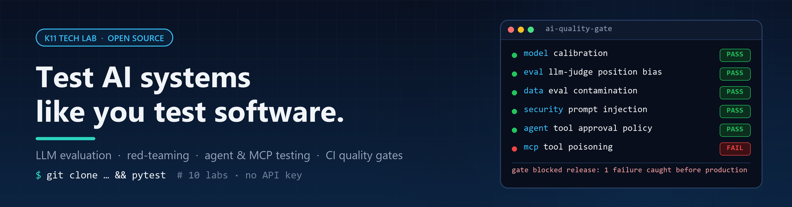

<div align="center">



# K11 Software Solutions LLC

**A woman-founded, research-led technology R&D and product development venture specializing in trustworthy AI, intelligent software quality, and engineering automation.**

**K11 Tech Lab** is our open-source research and engineering initiative. We turn research into developer tools, AI assurance workflows, and reproducible engineering experiments.

[](https://github.com/K11-Software-Solutions)
[](https://www.linkedin.com/in/kavita-jadhav-tech/)
[](https://www.linkedin.com/newsletters/trustworthy-ai-engineering-7521267953363832832/)
[](https://www.linkedin.com/newsletters/sdet-insights-7354009267919613954/)

</div>

---

## Mission and Product Direction

We build systems that help engineering teams measure software and AI quality, understand the impact of changes, and decide what is ready to release. Our goal is to make systems more reliable, observable, secure, and accountable from development through release.

| Focus | Product direction |
|---|---|
| Trustworthy AI | Evaluation and assurance tools for measuring model and agent behavior, documenting risks, and supporting review. |
| Intelligent software quality | Automated testing, cross-repository change impact analysis, and quality gates that account for uncertainty. |
| Engineering automation | Developer tools and CI/CD integrations that collect evidence, apply release policies, and surface decisions in pull requests. |

## Research and Development

Our applied research covers multi-agent CI/CD orchestration, AI evaluation, uncertainty-aware quality decisions, cross-repository contract and change impact analysis, and carbon-aware CI scheduling.

### Peer-reviewed publications

Kavita Jadhav published six papers on agentic AI quality engineering in the *International Journal of Engineering and Computer Science* (IJECS) in 2026. [Kavita Jadhav’s IJECS author profile](https://ijecs.in/author/kavita-jadhav-tech)

| Publication | Identifier | Reference implementation |
|---|---|---|
| [Autonomous CI/CD Quality Assurance Using LangGraph Multi-Agent Orchestration and Risk-Proportionate Human-in-the-Loop Control](https://ijecs.in/index.php/ijecs/article/view/5563) | [DOI](https://doi.org/10.18535/ijecs/v15i06.5563) | [agentic-ai-qa-system](https://github.com/K11-Software-Solutions/k11techlab-agentic-ai-qa-system) |
| [LLM Safety as a Quality Gate: Integrating Bias, Fairness, and Robustness Evaluation into CI/CD via GitHub Apps](https://ijecs.in/index.php/ijecs/article/view/5576) | [DOI](https://doi.org/10.18535/ijecs.v15i07.5576) | [llm-eval-agent-app](https://github.com/K11-Software-Solutions/llm-eval-agent-app) |
| [Beyond Static Gates: Closing the Detect–Fix–Learn Loop in Agentic CI/CD Quality Assurance](https://ijecs.in/index.php/ijecs/article/view/5577) | [DOI](https://doi.org/10.18535/ijecs.v15i07.5577) | — |
| [Cross-Repository Contract Testing and Change Impact Analysis in Microservice CI/CD: An Agentic AI Approach](https://ijecs.in/index.php/ijecs/article/view/5599) | [DOI](https://doi.org/10.18535/ijecs.v15i07.5599) | [microservice-qa-system](https://github.com/K11-Software-Solutions/k11techlab-microservice-qa-system) |
| [Beyond Binary Verdicts: Aleatoric Uncertainty Quantification in Agentic CI/CD Quality Pipelines](https://ijecs.in/index.php/ijecs/article/view/5614) | [DOI](https://doi.org/10.18535/ijecs.v15i07.5614) | — |
| [Beyond a Single Threshold: Uncertainty Source Classification and Type-Stratified Conformal Prediction for Agentic CI/CD](https://ijecs.in/index.php/ijecs/article/view/5684) | [DOI](https://doi.org/10.18535/ijecs.v15i08.5684) | — |

### Reported evaluation results

- **Cross-repository contract testing.** The published study reports 100% precision and recall across 74 evaluated pull requests, including 59 from external open-source repositories. [IJECS study](https://ijecs.in/index.php/ijecs/article/view/5599)
- **Carbon-aware CI scheduling.** The project reports a 31.4% reduction in estimated CI emissions compared with immediate scheduling, with no observed regression in test quality in an evaluation using telemetry from 180 pull requests. [Scheduler evaluation](https://github.com/K11-Software-Solutions/k11techlab-carbon-aware-ci-scheduler#results)

## Products and Developer Tools

K11 Tech Lab publishes open-source developer tools and reference implementations for AI assurance, software quality, and release readiness. These releases inform the development of reusable software products.

### MCP servers for QA teams

These Model Context Protocol (MCP) servers connect Claude and other MCP clients to QA tools that generate reviewable evidence from tests and checks.

| Server | What it does | Get it |
|---|---|---|
| **[k11 Playwright QA](https://github.com/K11-Software-Solutions/k11techlab-playwright-qa-mcp)**<br>[](https://glama.ai/mcp/servers/K11-Software-Solutions/k11techlab-playwright-qa-mcp) | Turns user stories into Playwright tests with locators verified on the live page. When a redesign breaks them, heals each locator with a confidence score, reasons and the runner-up, and `heal-ci` opens a pull request with an audit report. | [](https://www.npmjs.com/package/k11-playwright-qa-mcp)<br>`npx -y k11-playwright-qa-mcp` |
| **[k11 Selenium QA](https://github.com/K11-Software-Solutions/k11techlab-selenium-qa-mcp)**<br>[](https://glama.ai/mcp/servers/K11-Software-Solutions/k11techlab-selenium-qa-mcp) | The same for Selenium, in **Python (pytest)** and **Java (JUnit 5 / TestNG)**. Fixes broken locators where they live, in Page Objects and `@FindBy` annotations, re-runs the tests and reverts any fix that doesn't pass. | [](https://pypi.org/project/k11-selenium-qa-mcp/)<br>`uvx k11-selenium-qa-mcp` |
| **[k11 Appium QA](https://github.com/K11-Software-Solutions/k11techlab-appium-qa-mcp)** | Self-healing locators for native and hybrid **Android and iOS** apps: heals against the screen the test failed on, fixes Python and Java Page Objects, re-runs to verify, and flags elements with no accessibility id. CI runs it on a real Android emulator. | [](https://pypi.org/project/k11-appium-qa-mcp/)<br>`uvx k11-appium-qa-mcp` |
| **[k11 API Contract QA](https://github.com/K11-Software-Solutions/k11techlab-api-contract-qa-mcp)**<br>[](https://glama.ai/mcp/servers/K11-Software-Solutions/k11techlab-api-contract-qa-mcp) | Tells you which services an API change breaks before merge, and why, down to the fields each consumer reads or sends. Works for **OpenAPI, Swagger, GraphQL, gRPC, AsyncAPI and SOAP**, checks deployed services for drift, and posts the verdict on the pull request. | [](https://pypi.org/project/k11-api-contract-qa-mcp/)<br>`uvx k11-api-contract-qa-mcp` |
| **[k11 API Functional QA](https://github.com/K11-Software-Solutions/k11techlab-api-functional-qa-mcp)**<br>[](https://glama.ai/mcp/servers/K11-Software-Solutions/k11techlab-api-functional-qa-mcp) | Writes and runs functional API tests from user stories: chained calls, value checks, **database checks** that prove the change was stored, and negative and boundary tests generated from the spec (every bad input must get a 4xx, never a 5xx). Guardrails keep it away from production data. | [](https://pypi.org/project/k11-api-functional-qa-mcp/)<br>`uvx k11-api-functional-qa-mcp` |
| **[k11 API Security QA](https://github.com/K11-Software-Solutions/k11techlab-api-security-qa-mcp)** | **OWASP API Security Top 10** tests generated from your spec and run as two test users: can bob read alice's account (BOLA), broken auth, mass assignment, secrets in responses, admin-only operations. Also judges your scanners' SARIF: only findings new since main count, and accepted risks expire. Refuses production. | [](https://pypi.org/project/k11-api-security-qa-mcp/)<br>`uvx k11-api-security-qa-mcp` |
| **[k11 Integration QA](https://github.com/K11-Software-Solutions/k11techlab-integration-qa-mcp)** | Tests the chain between the parts of event-driven and batch systems: the API call, the **Kafka** message (checked against your AsyncAPI contract), the consumer's effect in the **database**, the **dead-letter queue** and the **batch job** (safe to rerun?). When an event doesn't arrive, it shows the closest message and how it differed. | [](https://pypi.org/project/k11-integration-qa-mcp/)<br>`uvx k11-integration-qa-mcp` |
| **[LLM Assure](https://github.com/K11-Software-Solutions/k11techlab-llm-assurance-toolkit)**<br>[](https://glama.ai/mcp/servers/K11-Software-Solutions/k11techlab-llm-assurance-toolkit) | Red-teams your chatbot, RAG app or agent: 41 probes mapped to the OWASP Top 10 for LLM Applications, adaptive multi-turn attacks driven by Claude, a CI gate and an audit-ready HTML report. | [](https://pypi.org/project/k11-llm-assure-mcp/)<br>`uvx k11-llm-assure-mcp` |
| **[k11 Performance QA](https://github.com/K11-Software-Solutions/k11techlab-performance-qa-mcp)** | Load tests from your API user-story flows (or your existing **JMeter** results): p95/p99, errors and throughput per endpoint against your SLOs, and regressions against a baseline that must be **statistically significant**, so noise doesn't block a release. k6 or builtin engine; refuses to load production. | [](https://pypi.org/project/k11-performance-qa-mcp/)<br>`uvx k11-performance-qa-mcp` |
| **[k11 Release Gate](https://github.com/K11-Software-Solutions/k11techlab-release-gate-mcp)**<br>[](https://glama.ai/mcp/servers/K11-Software-Solutions/k11techlab-release-gate-mcp) | Turns the evidence from all of the above (plus any JUnit report) into one release decision under a written policy: **ship, ship with conditions, needs a named person, or block**, with every reason, the evidence file it came from and its SHA-256. Deterministic, so it holds up in an audit. | [](https://pypi.org/project/k11-release-gate-mcp/)<br>`uvx k11-release-gate-mcp` |

All ten are in the official [MCP Registry](https://registry.modelcontextprotocol.io) and install as **Claude Code plugins**: the UI testing servers add `/story-to-test` and `/heal-tests` (Appium QA: `/heal-mobile-tests`), API Contract QA adds `/check-api-change` and `/api-contract-tests`, API Functional QA adds `/api-story-test` and `/api-negative-tests`, Performance QA adds `/perf-check` and `/perf-baseline`, API Security QA adds `/security-check`, Integration QA adds `/integration-check`, LLM Assure adds `/red-team` and `/assurance-report`, and Release Gate adds `/release-check`.

```text
/plugin marketplace add K11-Software-Solutions/k11techlab-playwright-qa-mcp
/plugin marketplace add K11-Software-Solutions/k11techlab-selenium-qa-mcp
/plugin marketplace add K11-Software-Solutions/k11techlab-appium-qa-mcp
/plugin marketplace add K11-Software-Solutions/k11techlab-api-contract-qa-mcp
/plugin marketplace add K11-Software-Solutions/k11techlab-api-functional-qa-mcp
/plugin marketplace add K11-Software-Solutions/k11techlab-api-security-qa-mcp
/plugin marketplace add K11-Software-Solutions/k11techlab-integration-qa-mcp
/plugin marketplace add K11-Software-Solutions/k11techlab-performance-qa-mcp
/plugin marketplace add K11-Software-Solutions/k11techlab-llm-assurance-toolkit
/plugin marketplace add K11-Software-Solutions/k11techlab-release-gate-mcp
```

### Release Readiness Agent

The **[k11 Release Readiness Agent](https://github.com/K11-Software-Solutions/k11techlab-release-readiness-agent)** is a Claude Code plugin for assessing whether a branch is ready to ship. The `/release-readiness:check` command identifies required checks, gathers evidence from the MCP servers in parallel, and returns a deterministic verdict with reasons for each blocker. The plugin is scoped to non-production environments and requires approval before making changes.

```text
/plugin marketplace add K11-Software-Solutions/k11techlab-release-readiness-agent
/plugin install release-readiness@k11-release-readiness
```

### Release Gate GitHub Action

The **[k11 Release Gate Action](https://github.com/K11-Software-Solutions/k11techlab-release-gate-action)** evaluates release readiness in CI. It uses the pull request diff to determine the required evidence and updates a pull request comment with the verdict, reasons, evidence files, and audit record on each push.

```yaml
- uses: K11-Software-Solutions/k11techlab-release-gate-action@v1
```

The [K11 Shop demo](https://github.com/K11-Software-Solutions/k11techlab-release-gate-demo) shows five example pull requests with verdicts based on unit, API, contract, security, and Kafka integration evidence.

### Additional tools and integrations

- **[LLM Assurance Toolkit](https://github.com/K11-Software-Solutions/k11techlab-llm-assurance-toolkit)** provides the CLI and CI gate behind the LLM Assure MCP server, with 41 OWASP LLM Top 10 probes and HTML reports for review.
- **[LLM Eval Agent](https://github.com/K11-Software-Solutions/llm-eval-agent-app)** is a GitHub App that publishes bias, fairness, and robustness scorecards as pull request check runs.
- **[Microservice QA System](https://github.com/K11-Software-Solutions/k11techlab-microservice-qa-system)** detects breaking API contract changes and identifies affected consumers before merge.
- **[Carbon-Aware CI Scheduler](https://github.com/K11-Software-Solutions/k11techlab-carbon-aware-ci-scheduler)** schedules test suites for periods of lower grid carbon intensity.
- **[LLM Testing Hub](https://github.com/K11-Software-Solutions/llm-testing-hub)** supports prompt regression testing, red-teaming, and risk audits with Promptfoo, LangTest, and DeepEval.

## Commitment to Responsible AI

We emphasize measurable evaluation, reproducibility, and transparent evidence. We test AI behavior against explicit criteria for reliability, safety, and fairness, and document the scope and limits of each evaluation.

We design automated workflows with safeguards and human oversight proportionate to risk. When evidence is ambiguous or a release decision carries higher risk, the workflow should surface the uncertainty and route the decision to a qualified reviewer.

## Open-Source Learning and Enablement

K11 Tech Lab publishes runnable labs, automation frameworks, and reference implementations that help engineers evaluate AI systems and apply the methods in their own CI/CD workflows.

### AI Quality Engineering curriculum

Start with the roadmap and work through the labs in order. The labs include local exercises that run without an API key, CI quality gates, and negative controls that demonstrate which failures the tests catch.

| # | Lab | What you'll learn to test |
|---|-----|---------------------------|
| 0 | [**becoming-ai-quality-engineer**](https://github.com/K11-Software-Solutions/becoming-ai-quality-engineer) | The roadmap: skills, tools, and a runnable RAG project with pytest, Playwright, Promptfoo and DeepEval |
| 1 | [llm-model-testing-lab](https://github.com/K11-Software-Solutions/llm-model-testing-lab) | Build a tiny GPT, then evaluate a real open-weights LLM: calibration, safety, bias, memorisation, quantization drift |
| 2 | [ai-evaluation-science-lab](https://github.com/K11-Software-Solutions/ai-evaluation-science-lab) | How far to trust an evaluator: LLM-judge bias, reliability statistics, sample sizes, drift |
| 3 | [ai-data-quality-lab](https://github.com/K11-Software-Solutions/ai-data-quality-lab) | Eval contamination, wrong labels, stale RAG documents, personal data, data contracts |
| 4 | [ai-security-testing-lab](https://github.com/K11-Software-Solutions/ai-security-testing-lab) | Prompt injection, jailbreaks, prompt leakage, exfiltration, excessive agency, with attack success rates |
| 5 | [agent-testing-lab](https://github.com/K11-Software-Solutions/agent-testing-lab) | Agents that take real actions: tools, approvals, trajectories, pass^k reliability |
| 6 | [multi-agent-testing-lab](https://github.com/K11-Software-Solutions/multi-agent-testing-lab) | Agent handoffs, relayed injection, blame assignment, loops, compounding failure |
| 7 | [mcp-testing-lab](https://github.com/K11-Software-Solutions/mcp-testing-lab) | The MCP supply chain: tool poisoning, rug pulls, cross-server shadowing |
| 8 | [ai-performance-cost-lab](https://github.com/K11-Software-Solutions/ai-performance-cost-lab) | Latency percentiles, time to first token, retry storms, cost per resolved request |
| 9 | [ai-production-monitoring-lab](https://github.com/K11-Software-Solutions/ai-production-monitoring-lab) | Tracing, online evals, drift, guardrails, shadow releases, incident triage |
| 🎓 | [**ai-assurance-case-lab**](https://github.com/K11-Software-Solutions/ai-assurance-case-lab) | Capstone: turn the evidence into one release argument mapped to NIST AI RMF, ISO/IEC 42001 and the EU AI Act |

### Test automation frameworks

Starter frameworks include page objects, CI pipelines, reporting, and AI-assisted test generation.

| Stack | Repository |
|-------|------------|
| Playwright + Python | [playwright-python-ai-assisted-framework](https://github.com/K11-Software-Solutions/k11techlab-playwright-python-ai-assisted-framework) |
| Playwright + TypeScript | [playwright-typescript-ai-augmented-framework](https://github.com/K11-Software-Solutions/K11TechLab-playwright-typescript-ai-augmented-framework) |
| Playwright + JavaScript | [playwright-javascript-ai-augmented-framework](https://github.com/K11-Software-Solutions/K11TechLab-playwright-javascript-ai-augmented-framework) |
| Vibium + Jest + TypeScript | [vibium-jest-ai-test-framework](https://github.com/K11-Software-Solutions/k11TechLab-vibium-jest-ai-test-framework) |
| Selenium + Java | [selenium-java-fullstack-framework](https://github.com/K11-Software-Solutions/k11TechLab-selenium-java-fullstack-framework) |
| Cucumber BDD + Java | [cucumber-bdd-java-fullstack-framework](https://github.com/K11-Software-Solutions/k11TechLab-cucumber-bdd-java-fullstack-framework) |
| Serenity BDD Screenplay | [serenity-screenplay-framework](https://github.com/K11-Software-Solutions/k11TechLab-serenity-screenplay-framework) |

## Founder and Engineering Leadership

**[Kavita Jadhav](https://www.linkedin.com/in/kavita-jadhav-tech/)** founded K11 Software Solutions LLC and leads its engineering and applied research through K11 Tech Lab. A senior software development engineer in test (SDET) and AI quality engineer, she brings more than 12 years of test automation experience, including work for VMware, E\*TRADE/Morgan Stanley, Verizon, Delta Dental, and Wells Fargo.

K11 also offers specialized consulting, implementation support, and technical training to help engineering teams adopt and extend these technologies. [Contact K11 Software Solutions](https://k11softwaresolutions.com/contact)

### Websites and newsletters

- [Trustworthy AI Engineering](https://www.linkedin.com/newsletters/trustworthy-ai-engineering-7521267953363832832/) covers practical AI assurance every two weeks.
- [SDET Insights](https://www.linkedin.com/newsletters/sdet-insights-7354009267919613954/) covers test automation weekly.
- [k11softwaresolutions.com](https://k11softwaresolutions.com/) · [softwaretestautomation.org](https://www.softwaretestautomation.org/)
